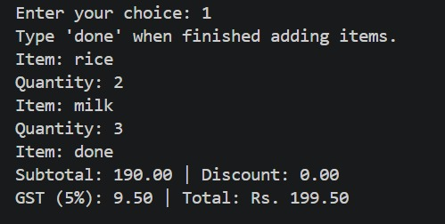
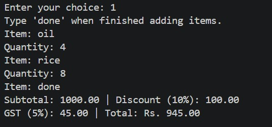
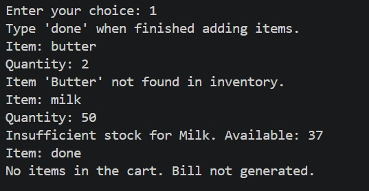
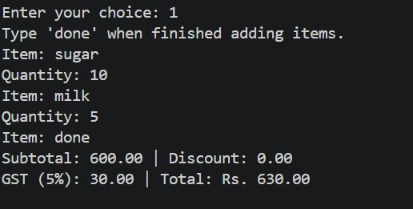

# Project Report & Summary: Grocery Store Management System

**Name:** Shree Tiwari | **Section:** J | **Roll No.:** 00786

## 1. Problem Definition
Manual billing in small retail and grocery stores is time-consuming and prone to calculation errors, especially when tracking remaining inventory and applying conditional discounts or taxes. The objective of this project is to develop a console-based **Grocery Store Management System** in **Python 3** that automates customer billing, enforces stock validation, applies discount and GST rules accurately, and keeps text-file records of every bill and the updated stock level.

---

## 2. System Requirements & Business Logic
The application manages four core grocery products with predefined unit prices and initial stock quantities:
* **Rice:** Rs. 50/kg (Initial Stock: 100)
* **Sugar:** Rs. 45/kg (Initial Stock: 50)
* **Milk:** Rs. 30/L (Initial Stock: 40)
* **Oil:** Rs. 150/L (Initial Stock: 20)

### Calculation Rules
1. **Subtotal:** Sum of (Unit Price x Quantity) for all items in the customer's cart.
2. **Discount:** 10% of the subtotal if Subtotal >= Rs. 1000; otherwise Rs. 0.00.
3. **GST:** 5% calculated on the post-discount amount (Subtotal - Discount).
4. **Final Total:** (Subtotal - Discount) + GST.

---

## 3. Data Structures & Concepts Used
* **Dictionary (`inventory`):** Maps each product name (key) to a list containing its unit price and current stock quantity (`[price, stock]`), enabling fast lookups and real-time stock updates.
* **List (`cart`):** Temporarily stores purchased items as nested lists (`[item, quantity, price, line_total]`) during an active billing session.
* **Control Structures:** Uses `while` loops for continuous menu navigation and item entry, `for` loops for iterating through carts and inventory, and `if-elif-else` blocks for input validation and discount thresholds.
* **File Handling:**
  * `bills.txt` is opened in **append mode (`"a"`)** to log every finalized bill without overwriting previous bills.
  * `stock.txt` is opened in **write mode (`"w"`)** after each bill to save the updated inventory counts.

---

## 4. Algorithm / Program Flow
1. **Start** the program. The `inventory` dictionary is created with the initial prices and stock.
2. **Display Main Menu:**
   * Option `1`: Create a New Bill
   * Option `2`: View Current Stock
   * Option `3`: Exit Application
3. **Billing Workflow (Option 1):**
   * Initialize an empty `cart` list.
   * Prompt the cashier for an item name until `'done'` is entered.
   * Validate that the item exists in `inventory` and that the requested quantity is valid and does not exceed available stock (including items already added to the current cart).
   * Append valid items to `cart`.
   * Compute **Subtotal**, **Discount** (10% if 1000 or more), **GST** (5%), and **Final Total**.
   * Print the bill summary, deduct sold quantities from `inventory`, append the bill to `bills.txt`, and save the updated stock to `stock.txt`.
4. **Stock Inspection (Option 2):** Display the remaining stock count for all items.
5. **Terminate** cleanly when Option `3` is selected.

---

## 5. Test Case Verification Summary
All four test cases were executed (each as a fresh run of the program) and verified:
* **Test Case 1 (Normal Input):** `Rice: 2`, `Milk: 3` -> `Subtotal: 190.00`, `Discount: 0.00`, `GST (5%): 9.50`, `Total: Rs. 199.50`.
* **Test Case 2 (Boundary Input):** `Oil: 4`, `Rice: 8` -> exact `Subtotal: 1000.00` triggers `Discount (10%): 100.00`, `GST (5%): 45.00`, `Total: Rs. 945.00`.
* **Test Case 3 (Invalid Input):** `Butter: 2` and `Milk: 50` -> graceful error handling (`Item 'Butter' not found in inventory.` and `Insufficient stock for Milk. Available: 40`).
* **Test Case 4 (Stock Deduction):** `Sugar: 10`, `Milk: 5` -> `Total: Rs. 630.00`, and the remaining stock shows `Rice: 100 | Sugar: 40 | Milk: 35 | Oil: 20`.

The resulting `bills.txt` contains one bill for each of Test Cases 1, 2 and 4 (Test Case 3 generates no bill), and `stock.txt` shows the stock after Test Case 4.

---
## 6. Screenshots
### Test Case 1: Normal Input

### Test Case 2: Boundary Input

### Test Case 3: Invalid Input

### Test Case 4: Stock Deduction

---

## 7.Conclusion
The **Grocery Store Management System** fulfills all functional and technical requirements of Problem Statement No. 72. By combining Python dictionaries, lists, conditional validation, and text-file storage, the application reduces manual billing errors and provides a reliable, lightweight point-of-sale solution.
